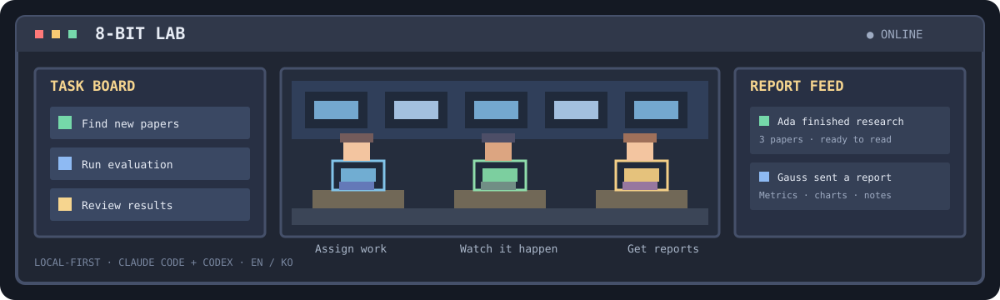

<p align="center"></p>

<h1 align="center">👾 8-bit Lab</h1>

<p align="center"><strong>AI 팀이 일하는 픽셀아트 사무실.</strong><br>Claude Code 또는 Codex 직원에게 일을 맡기고, 진행 상황을 보고, 필요한 작업을 승인하고, 보고를 한곳에서 받으세요.</p>

<p align="center">
  <a href="https://github.com/turtle505/eightbit-lab/actions/workflows/ci.yml"></a>
  <a href="LICENSE"></a>
  <a href="package.json"></a>
  <a href="package.json"></a>
  <a href="README.md"></a>
</p>

<p align="center"><a href="README.md">English</a> · <strong>한국어</strong> &nbsp;|&nbsp; <a href="#왜-만들었나">왜 만들었나</a> · <a href="#설치">설치</a> · <a href="#튜토리얼">튜토리얼</a> · <a href="#조작법">조작법</a> · <a href="#추가-기능">기능</a> · <a href="#안전장치">안전장치</a></p>

## 왜 만들었나

Claude Code나 Codex를 터미널 여러 개에 띄워 놓고 일을 시키면, 창이 몇 개만 넘어가도 누가 뭘 하는지 따라가기 어렵습니다. 승인을 기다리며 멈춘 창을 뒤늦게 발견하거나, 끝난 결과를 찾으려고 스크롤을 뒤지게 됩니다.

8-bit Lab은 그 에이전트들을 한 화면에 모은 것입니다. 캐릭터를 보면 각자 지금 뭘 하는지 알 수 있고, 파일 삭제나 git push, 연구실 서버 접근처럼 조심해야 하는 작업은 실행 전에 물어봅니다. 끝난 일은 보고 피드와 작업 보드에 남습니다. 반복 작업은 루틴으로 예약할 수 있고, GPU 작업이 끝나면 그 작업을 돌린 직원이 결과를 보고합니다.

원래 대학원 연구실에서 혼자 쓰려고 만들었습니다. 그래서 기본 직원이 문헌 조사, 평가, 실험 담당으로 짜여 있지만, 역할은 설정 파일에서 바꿀 수 있습니다.

| 우리 팀 | 내 책상 |
|---|---|
| 🧑‍💻 **기본 직원 6명**이 리서치·평가·개발·조율을 맡습니다. 직원마다 Claude Code와 Codex를 고를 수 있습니다. | 👀 **실시간 픽셀 사무실**에서 생각·편집·명령 실행·승인 대기 상태를 봅니다. |
| 📋 **작업 보드와 보고서**에 담당자, 결과, 저장된 Markdown 보고서가 모입니다. | ✋ **승인 카드**에서 민감한 작업을 확인합니다. 원격 랩 접근은 항상 묻습니다. |
| ⏰ **루틴**으로 반복 작업을 예약합니다. | 🖥️ **GPU 작업**을 SSH·Slurm 서버에서 실행하고 끝나면 결과를 보고받습니다. |

macOS 또는 Linux에서 로컬로 실행하며 CLI 로그인으로 사용합니다. Claude Code는 Claude Pro/Max 요금제, Codex는 ChatGPT 로그인을 사용합니다. 앱에 API 키는 필요하지 않습니다. 팀의 분야를 한 줄로 설정하거나 기본값으로 시작하세요.

> **프로젝트 상태:** 매일 사용하며 계속 다듬고 있습니다. Anthropic·OpenAI와 무관한 독립 프로젝트입니다.

---

## 설치

### 준비물

- **Node.js 22.13 이상** (24 권장): 내장 `node:sqlite`를 쓰는데, 그보다 낮은 버전에서는 플래그를 켜야만 쓸 수 있습니다. nvm을 쓴다면 `nvm use`로 맞는 버전이 잡히고(`.nvmrc`), 버전이 낮으면 `npm start`가 분명한 안내와 함께 멈춥니다.
- **Claude Code CLI**에 Pro 또는 Max 요금제로 로그인. `claude`를 한 번 실행해 로그인하고, `claude --version`으로 확인하세요.
- macOS 또는 Linux. 선택: `pdftotext`(poppler)가 있으면 PDF 첨부를 글로 넘겨서 토큰이 훨씬 덜 듭니다.

### 실행

```bash
git clone https://github.com/turtle505/eightbit-lab.git
cd eightbit-lab
npm install
npm run dev
```

**http://localhost:5173** 을 엽니다. 시작하는 데 설정은 필요 없습니다.

화면이 영어로 나오면 오른쪽 위 **한국어** 버튼을 누르세요. 선택은 기억됩니다.

---

## 튜토리얼

당신은 사무실 아래쪽 큰 책상에 앉은 **매니저**입니다. 직원 6명은 휴게 공간에서 ☕를 마시며 지시를 기다리고 있습니다. 네 스테이지를 순서대로 깨면 기본 조작을 다 익힙니다.

### 스테이지 1: 첫 지시

1. 직원 **Alan**을 클릭합니다 (또는 숫자키 <kbd>1</kbd>).
2. 사무실 아래 입력칸에 적고 Enter: *"retrieval-augmented generation 최신 논문 3편 찾아서 요약해줘."*
3. Alan이 책상으로 걸어가 일하기 시작합니다. 머리 위 말풍선에 지금 하는 일이 나옵니다.

> 💡 직원마다 첫 지시는 세션을 여느라 몇 초 걸립니다. 그다음부터는 거의 바로 시작합니다.

**클리어 조건:** Alan이 책상에서 타이핑한다.

### 스테이지 2: 승인하기

직원이 **`!`를 띄우고 손을 들면** 당신의 허락이 필요하다는 뜻입니다. 노란 승인 패널에서 무엇을 하려는지 읽고 **승인**하거나 **거부**하세요. 위험한 작업(삭제, git push, 원격 서버 접근 등)에는 경고 표시가 붙습니다.

**클리어 조건:** 승인 카드 하나를 처리한다. (손을 안 들고 끝냈다면 이 스테이지는 건너뛴 것입니다.)

### 스테이지 3: 보고 받기

일이 끝나면 직원 위에 ✨가 반짝이고, 답이 **📨 보고** 피드에 도착합니다. 데스크톱 알림을 켜 두면 알림도 옵니다.

**클리어 조건:** 보고 피드에서 Alan의 요약을 읽는다.

### 스테이지 4: 작업 카드

큰 일은 말로 시키는 대신 카드로 맡깁니다.

1. 오른쪽 **작업 보드**에 제목을 적고 **추가**.
2. 카드를 사무실의 직원에게 끌어다 놓습니다.
3. 끝난 카드는 보고서와 함께 *검토* 칸으로 넘어옵니다. 제목을 눌러 읽고 **완료**.

**클리어 조건:** 카드 하나가 *완료* 칸에 들어간다. 여기까지 왔으면 기본 조작은 끝입니다.

### 보너스 스테이지: 구석의 두 사람과 교수님

왼쪽 아래 러그 위에 책상 없이 서 있는 **Kang**(<kbd>7</kbd>)과 **On**(<kbd>8</kbd>)은 일을 하지 않습니다. 힘든 날 말을 걸어 보세요. 대화가 게임 대사처럼 말풍선으로 오갑니다.

- **Kang**: 뭘 말해도 한숨 쉬고 비꼽니다. 위로는 기대하지 마세요.
- **On**: 상담사처럼 질문하면서 생각을 정리하도록 돕습니다.
- **교수님**(<kbd>9</kbd>): 오른쪽 단상에 서 있습니다. 뭘 말해도 "그래서 결과는 나왔나?"로 돌아오는 현실 교수님 풍자입니다. `어록: 그거 금방 하지?`처럼 보내면 실제 교수님 어록을 배워서 응용합니다.

---

## 조작법

튜토리얼을 깼다면 여기가 전체 조작표입니다.

| 행동 | 조작 |
|---|---|
| 지시하기 | 직원 클릭 (또는 사무실 바로 아래 입력칸에서 직원 선택) → 입력하고 Enter. <kbd>/</kbd>로 입력칸 바로 가기 |
| 작업 배정 | 작업 보드에 카드 추가 → 직원에게 드래그 (또는 카드의 드롭다운) |
| 승인 / 거부 | 노란 승인 패널 (콘솔 화면에서는 <kbd>a</kbd> / <kbd>d</kbd>) |
| 결과 확인 | 끝난 카드는 **검토**로 이동 (최신이 위) → 카드 제목을 눌러 보고를 펼치고 **완료**, 한꺼번에는 **모두 완료**. 완료 칸은 최근 5개만 보입니다 |
| 연구 주제별로 묶기 | 작업 폼의 **주제** 칸 (예: `design-survey`, 전에 쓴 주제가 목록으로 나옵니다). 그 작업의 보고서는 `reports/<주제>/` 아래에 저장되고, 이어 붙인 작업은 앞 작업의 주제를 물려받습니다. 폴더 이름이 되므로 영문 소문자·숫자·하이픈만 씁니다 |
| 지난 보고서 | **보고서** 탭: 모든 `.md` 보고서를 폴더 트리로, 안 읽은 개수와 함께. **주제별로 보기**를 켜면 직원 대신 주제로 묶입니다 |
| 연구 노트 남기기 | 따로 할 일은 없습니다. 작업이나 GPU 작업이 끝날 때마다 사무실이 `workspaces/notebook/<날짜>.md`에 한 항목(시각, 작업, 담당, 주제, 결과 앞부분, 결과에 나온 파일)을 덧붙입니다. 입력칸에 `/note 내용`을 치면 직원에게 가지 않고 노트에 내 메모로 들어갑니다. 보고서 탭의 **notebook** 폴더에서 읽습니다. AI를 부르지 않으므로 사용량이 들지 않고, `office.local.yaml`에 `notebook: false`를 두면 꺼집니다 |
| 실험 결과 비교 | job 패널의 **📊 실험 비교**: 실험 하나가 한 줄이고, 돌릴 때의 설정과 나온 지표가 열로 나옵니다. 주제로 거르고, 열 이름을 눌러 정렬하고, 지표마다 가장 좋은 값이 굵게 표시됩니다 (↑↓로 큰 값과 작은 값 중 어느 쪽이 좋은지 바꿈). **CSV 복사**로 스프레드시트에 붙일 수 있습니다. 줄은 직원이 결과를 기록할 때 생깁니다. GPU 작업이 끝나면 기록하라는 지시가 자동으로 가고, 그 밖의 실험도 "체크포인트 평가하고 수치 기록해 줘"처럼 시키면 같은 도구로 기록합니다 |
| 지난 기록 찾기 | 상단 검색 칸 (<kbd>Ctrl</kbd>/<kbd>⌘</kbd>+<kbd>K</kbd>): 보고서 본문, 직원 대화 로그, 작업 카드, 보고 피드, 기록된 실험에서 찾습니다. 낱말을 여러 개 쓰면 모두 들어 있는 것만 나옵니다 |
| 끝나지 못한 작업 다시 시키기 | 실행이 실패한 카드는 **진행 중** 칸에 빨간 ⚠와 이유가 붙은 채 남습니다. 내가 멈춘 카드는 ⏹, 서버가 다시 시작되면서 끊긴 카드도 표시됩니다. **↻ 다시 시도**를 누르면 같은 직원이 다시 시작하고, 앞선 시도가 어떻게 끝났는지 지시문으로 전달됩니다. 다른 직원에게 넘기려면 카드의 드롭다운에서 고르면 됩니다. 이 카드를 기다리는 뒷 작업에는 그동안 *#n 실패로 대기*가 표시됩니다 |
| 멈추기 | 직원 패널의 **중지** (지금 턴만 끝내고 대화는 유지) |
| 새로 시작 | 직원 패널의 **새 세션** (대화를 비움) |
| 나중에 한 번만 시키기 | 작업 폼의 ⏰ (담당 직원과 시각 선택), 또는 비서에게 *"내일 9시에 Alan한테 새 논문 정리시켜줘"* |
| 앞 작업이 끝나면 시작하게 하기 | 작업 폼의 **⛓ 바로 시작** 칸에서 앞 작업을 고르고 담당 직원을 정합니다. 카드는 기다렸다가 앞 작업이 끝나면 저절로 시작하고, 앞 작업의 결과를 지시문으로 넘겨받습니다. 카드의 **▶ 지금 시작**을 누르면 기다리지 않습니다. 팀장도 일을 나눠 줄 때 같은 방식으로 겁니다 |
| 반복 작업 예약 | 루틴 패널 → **+ 새 루틴**, 또는 비서에게 부탁 |
| 사무실 업데이트 | 원격에 새 커밋이 있으면 상단 바에 뜨는 **⬆ 새 버전 n** → 바뀐 내용 확인 → **업데이트** (*나중에 업데이트할 때* 참고) |
| 화면 전환 | 오른쪽 위 **게임 / 콘솔 / 보고서 / 프로젝트**, 또는 <kbd>`</kbd> |
| 언어 전환 | 오른쪽 위 **EN / 한국어** 버튼 |
| 사무실 이름 바꾸기 | 상단의 제목을 클릭합니다. 브라우저 탭, 데스크톱 알림, 로그인 화면에도 같은 이름이 나옵니다. 비우면 "8-bit Lab"으로 돌아갑니다 |

**화면.** *게임*은 픽셀 사무실입니다. *콘솔*은 같은 데이터를 표로 보여줍니다(직원, 작업, 전체 활동 피드, 승인). 키보드로 다 다룰 수 있습니다. *보고서*는 보고서 파일 읽기용입니다. URL에 `?view=console`, `?view=reports`를 붙이면 바로 열립니다.

**단축키** (콘솔): <kbd>1</kbd>–<kbd>6</kbd> 선택 · <kbd>j</kbd>/<kbd>k</kbd> 이동 · <kbd>/</kbd> 지시 · <kbd>a</kbd>/<kbd>d</kbd> 승인/거부 · <kbd>Esc</kbd> 해제. 어느 화면에서든 <kbd>Ctrl</kbd>/<kbd>⌘</kbd>+<kbd>K</kbd>로 기록을 검색합니다.

**상태 표시.** 캐릭터를 보면 지금 뭘 하는지 알 수 있습니다.

| 보이는 모습 | 상태 |
|---|---|
| ☕ 휴게 공간 | 쉬는 중 |
| 책상에서 타이핑 | 일하는 중. 모니터가 파랑이면 편집, 초록이면 명령 실행, 하늘색이면 웹 검색 |
| `...` | 생각 중 |
| ✋ `!` 띄우고 손 듦 | 내 승인 대기 |
| ✨ 반짝임 | 방금 끝남 |

**구독 사용량.** 상단 바에 Claude 요금제의 **5시간·주간 사용량**과 초기화 시각이 나옵니다. 직원 패널의 숫자는 한도 대비 %가 아니라 사무실 전체 사용량 중 *그 직원의 몫*입니다. 일하다 5시간 한도가 다 차면 직원이 멈췄다가 **초기화되면 알아서 이어서** 합니다. 기다리기 싫으면 **▶️ 지금 이어서**를 누르세요.

---

## 내 환경에 맞추기

설정은 모두 `config/`에 있습니다. **개인 설정은 커밋된 파일을 고치지 말고** 옆에 `config/<이름>.local.yaml`로 두세요. git에서 제외되고, 기본 파일 위에 덮어씁니다.

- `office.local.yaml`은 키 단위로 덮어씁니다.
- 직원·루틴·서버 목록은 같은 `id`(서버는 `name`)면 기본값을 바꾸고, 새 항목은 추가합니다.

```yaml
# config/office.local.yaml (흔한 예)
domain: "a computer-vision lab working on video understanding"   # 우리 팀이 하는 일, 한 줄 (영어 권장: 프롬프트가 영어)
language: ko              # ko | en: 화면 언어이자 직원들이 보고하는 언어
maxConcurrent: 3          # 동시에 일하는 직원 수 (구독 rate limit 보호)
researchRepo: ~/research/my-model   # 선택: 엔지니어마다 이 저장소의 git worktree를 따로 줌
authToken: ""             # 선택: 사무실에 비밀번호 걸기 ("안전장치" 참고)
```

| 파일 | 하는 일 |
|---|---|
| `config/office.yaml` | 우리 분야(`domain`), 동시 실행 수, 모델, 언어, 유휴 시간, 호스트, 로컬 모델 |
| `config/roles.yaml` | 직원: 이름, 역할 프롬프트, 승인 없이 쓸 도구(`autoAllow`), 캐릭터 색과 `look`(머리 모양·모자) |
| `config/routines.yaml` | 시작용 루틴: 평일 09:00 아침 브리핑, 평일 18:00 저녁 리포트, 금 17:00 주간 회고(꺼짐) |
| `config/servers.local.yaml` | 내 GPU 서버 (`servers.example.yaml` 복사) |

**작업 폴더.** `researchRepo`를 정하면 엔지니어마다 자기 git worktree(브랜치 `office/<id>`)에서 일하므로 서로 충돌하지 않습니다. 정하지 않으면 모두 `workspaces/shared`를 같이 씁니다. 보고서는 `workspaces/<직원>/reports/`에 쌓이고, 그 안에서는 모든 직원이 같은 규칙을 따릅니다. 연구 주제가 있는 보고서는 `reports/<주제>/<날짜>-<짧은-제목>.md` (그림과 데이터는 그 옆 `figures/`, `data/`, 주제의 보고서 목록은 `README.md`), 반복 브리핑은 `reports/daily/`, 한 번짜리는 `reports/misc/`입니다. 보고서 첫머리는 늘 같은 형식(날짜, 작성자, 작업 번호, 주제, 상태, 읽은 것, 만든 것)이고, 스크립트 같은 중간 산출물은 `reports/`가 아니라 `work/<주제>/`에 둡니다. 규칙은 `roles.yaml`의 `common:` 블록에 있고 앞으로 쓰는 보고서부터 적용됩니다. 예전 보고서는 그대로 두며, 옮기고 싶으면 비서에게 정리를 시키면 됩니다.

**팀.**

| id | 누구 | 하는 일 |
|---|---|---|
| `lit` | Alan | 논문·웹 리서치 |
| `eval` | Gauss | 지표 계산, 그림, 평가 보고서 |
| `aide1`, `aide2` | Finn, Mira | 넘겨받은 일은 뭐든 하는 연구 보조 |
| `sec` | Hana | 비서: 루틴, 사무실 현황, 보고서 정리 |
| `exec` | Linus 👑 | 실행 팀장: 일을 받으면 먼저 쪼개서 다른 직원에게 나눠 주고, 코드 구현과 GPU job, 결과 취합은 직접 함 |
| `thug` | Kang | 뭘 말해도 한심하다는 듯 한숨 쉬고, 변명하면 팩트로 때리는 양아치 (위로는 안 함) |
| `counsel` | On | 상담 기법으로 생각을 정리하도록 돕는 상담사 (지난 상담을 메모로 이어 감) |
| `prof` | Professor | 현실 교수님 풍자. 도움은 안 되고 일만 늘립니다 |

Kang과 On은 일이 아니라 매니저의 기분을 맡습니다. 책상 없이 왼쪽 아래 구석 러그 위에 서 있고, 한두 문장으로 짧게 말합니다. 대화는 말풍선으로 보입니다. 답은 그 사람 머리 위에, 내가 한 말은 매니저 머리 위에 뜹니다. 사무실 언어로 답하고(한국어에서는 스스로를 깡·온이라고 부릅니다) 숫자키 <kbd>7</kbd>/<kbd>8</kbd>로 고를 수 있으며, 팀장은 이 둘에게 일을 넘기지 않습니다. Kang은 내가 한 말을 놀릴 거리로 `workspaces/thug/notes.md`에 조용히 적어 두므로 새 세션을 열어도 기억합니다. On도 상담 내용을 `workspaces/counsel/notes.md`에 적어 두고 다음 상담에서 이어 갑니다. 잊게 하려면 그 파일을 지우세요.

교수님도 일을 하지 않는 대화 상대입니다. 어록은 채팅으로 `어록: …`이라고 보내거나 `workspaces/prof/quotes.md`에 `- ` 한 줄씩 직접 적으면 됩니다. 이 파일은 git에 올라가지 않습니다. 이름은 직원 패널의 ✏️로 바꿉니다.

**우리 분야에 맞추기.** 보통은 `domain`만 정하면 충분합니다. 모든 직원의 프롬프트가 `About this team: <domain>`으로 시작합니다. 더 맞추고 싶으면(예: 평가 분석가가 우리 분야 지표를 알게, 리서처가 설치해 둔 논문 검색 MCP 서버를 쓰게) `config/roles.local.yaml`에서 그 직원을 덮어쓰세요. `id`로 찾아 항목별로 합쳐집니다.

```yaml
# config/roles.local.yaml
employees:
  - id: lit
    autoAllow: [Read, Glob, Grep, WebSearch, WebFetch, Write, Edit, TodoWrite, mcp__arxiv]   # + 내 MCP 서버
  - id: eval
    systemPrompt: |
      ## Your role: Evaluation Analyst
      You compute and interpret mAP, IoU and per-class recall for our detection models …
```

각 역할 프롬프트 앞에는 `roles.yaml`의 `common:` 블록(정직하게 보고하기, 바꾸기 전에 읽기, 보고 형식)이 공통으로 붙고, GPU 서버나 원격 호스트가 있으면 `servers:` 블록(원격 서버 예절)도 붙습니다. 직원을 빼도 그 직원의 작업 카드는 사라지지 않고 *미배정*으로 돌아갑니다.

**언어.** 직원들이 받는 지시는 늘 영어이고, *보고하는* 언어만 설정을 따릅니다. 헤더 버튼이 `language:`보다 우선하며 기억됩니다. 이미 쌓인 로그와 피드는 쓰인 언어 그대로 남고, 이미 저장된 루틴은 다시 번역되지 않습니다.

**비서와 루틴 만들기.** Hana에게 *"매주 금요일 5시에 이번 주 다들 뭐 했는지 정리해줘"*라고 말하세요. 몇 가지 물어본 뒤 순서를 **사무실 스킬**(`workspaces/office-skills/skills/<이름>/SKILL.md`)로 적어 두고, 그걸 실행하는 루틴을 등록합니다. 스킬에는 승인 없이 실행할 명령(`office-allow`)을 적을 수 있습니다. 단, 파일이 내가 승인한 내용 그대로일 때만입니다. 바뀌면 루틴 패널에 **⚠️ 재승인 필요**가 뜹니다. 루틴은 5필드 cron, 백엔드가 도는 기기의 현지 시각 기준이며, 백엔드가 켜져 있을 때만 돕니다.

---

## 추가 기능

### Codex 직원

직원의 작업이 끝난 뒤 직원 패널의 실행기 선택에서 **Codex**를 고를 수 있습니다. 선택은 저장되며, Claude로 다시 전환하면 별도로 보존된 Claude 대화를 이어갑니다. Codex는 백엔드 머신의 로컬 app-server와 ChatGPT 로그인을 사용하므로 공식 Codex CLI를 설치하고 `codex login`을 실행하세요. 직원이 원격 host에서 일한다면 그 host에도 설치하고 로그인해야 합니다. 비로그인 SSH 셸에서 CLI를 찾지 못하면 `office.local.yaml`의 해당 host에 절대 경로 `codexPath`를 지정하세요. 화면이 없는 host에서는 `codex login --device-auth`를 사용할 수 있습니다. Codex는 직원 대화를 재개할 때도 해당 host의 CLI 모델 설정을 적용합니다. 계정에서 기본 모델을 거부한다면 그 host의 `~/.codex/config.toml` 맨 위에 `model = "<사용 가능한 모델>"`을 설정하세요. 작업 보드, 보고 피드, 승인 카드, 사무실·랩 도구는 동일하게 사용합니다. 자동 모드에서는 일반 명령과 파일 변경 승인을 자동 처리하고, SSH·랩 접근, 일부 위험 명령, 추가 파일시스템 권한 요청은 승인 카드로 남깁니다. 백엔드 host의 Codex 계정에서 한도 정보를 제공하면 상단에 Claude와 별도로 남은 사용량을 표시합니다.

**팀장이 작업마다 고르기.** 팀장(또는 비서)이 일을 나눠 줄 때, 그 직원의 설정은 그대로 두고 작업 하나만 다른 실행기로 돌릴 수 있습니다. 웹 조사는 Claude로(Codex는 네트워크가 꺼져 있음), 끝난 작업은 그 일을 하지 않은 쪽 실행기로 독립 검수, 한도가 거의 찬 쪽 대신 다른 쪽으로 보내는 식입니다. 이런 카드에는 **Claude** / **Codex** 배지가 붙습니다. *"Finn한테 Claude로 짜게 하고, Codex로 검수시켜줘"*처럼 직접 부탁해도 됩니다.

<details>
<summary><b>🖥️ GPU 서버 (job 올리고 추적하기)</b></summary>

`config/servers.example.yaml`을 `config/servers.local.yaml`로 복사해 서버를 적습니다. 서버마다 `type: ssh` 또는 `type: slurm`과 `~/.ssh/config`의 `ssh_host` 별칭을 적는데, **비밀번호 없이 키로 접속돼야** 합니다. 백엔드가 그 기기에서 돈다면 `ssh_host: local`로 두세요.

그러면 직원들이 `mcp__lab__*` 도구를 씁니다: `list_servers`, `gpu_status`, `submit_job`, `job_status`, `tail_log`, `cancel_job`, `fetch_results`. `submit_job`은 실험 설정(`params`)과 주제도 받고, `record_result`는 최종 지표를 실험 비교 표에 적습니다. `record_result`는 서버를 등록하지 않아도 쓸 수 있고, 사무실 자체 DB에만 쓰기 때문에 승인을 묻지 않습니다. job은 job 패널에 나오고, 끝나면 올린 직원이 자동으로 알림을 받아 결과를 보고합니다.
</details>

<details>
<summary><b>📁 프로젝트 세션 (아무 폴더에서 Claude Code 세션)</b></summary>

**프로젝트** 탭에서 호스트와 이미 있는 폴더를 고르면 그 폴더에서 Claude Code 세션이 열립니다. `ssh host`, `cd ~/project/x`, `claude`와 같지만 승인·로그·보고가 붙습니다. 한 프로젝트에서 서로 독립된 세션을 여러 개 돌릴 수 있습니다.

- 세션은 탭 안에만 있습니다. **사무실에 들이기**를 누르면 책상과 캐릭터가 생깁니다.
- 직원과 같은 승인 규칙을 따르고, `maxConcurrent`에도 포함됩니다.
- 세션을 닫으면 대화는 버려지고 파일은 남습니다.
</details>

<details>
<summary><b>🌍 다른 기기에서 세션 돌리기 / 백엔드 옮기기</b></summary>

`office.local.yaml`의 `hosts`에 기기를 적고, 직원이나 프로젝트에 `host: <id>`를 주세요.

```yaml
hosts:
  - { id: desktop, name: "🖥 desktop", ssh: local, projectRoot: "~/project" }
  - { id: gpu1, name: "🧮 gpu1", ssh: gpu1, projectRoot: "~/project", claudePath: "/home/me/.local/bin/claude" }
```

- `ssh: local`은 백엔드가 도는 기기입니다. 나머지는 ssh 별칭(키 인증)입니다.
- 기기마다 `claude` 설치와 로그인이 필요합니다. 비대화형 ssh에는 보통 `~/.local/bin`이 PATH에 없으므로 `claudePath`는 **절대 경로**로 적으세요.
- 원격 세션은 첨부 파일을 못 읽습니다(백엔드 디스크에 있으므로).
- 대화는 그걸 돌린 기기에만 있어서, 직원을 다른 기기로 옮기면 새 세션으로 시작합니다.

**공용 서버는 접속이 잦은 클라이언트를 막고, 학교 네트워크는 짧은 시간에 새 ssh 접속이 여러 번 생기면** 공격으로 보고 회선을 끊을 수 있습니다. 그래서 사무실은 명령 수가 아니라 접속 수를 줄입니다.

- **서버당 접속 하나.** 사무실이 한 서버에서 하는 일(직원 세션, Codex 지시, GPU 조회, 결과 가져오기, 첨부 전송, 로컬 모델 터널)은 전부 공유 ssh 접속 하나 안에서 돕니다. 한 서버에서 열 명이 일해도 접속은 하나입니다. 그 접속이 끊기면 그 위의 세션이 같이 닫힙니다. 대화는 남아 있어서 다음 지시 때 다시 연결해 이어가고, 끊긴 작업은 다시 시도할 수 있게 표시됩니다.
- **새 접속 예산**: 호스트별 `sshPerMinute`(기본 5, `hosts` 항목에서 호스트별로 지정, `0` = 무제한)와 기기 전체 `sshPerMinuteTotal`(기본 4). 서버의 접속을 여는 것만 세므로 조회 때문에 예산이 바닥나지 않습니다.
- **직원이 직접 치는 명령도 셉니다.** 한 명령 안의 `ssh`/`scp`/`rsync`가 하나씩 자리를 쓰고, 예산을 넘으면 "N초 뒤 다시 시도" 안내와 함께 거부됩니다. 반복문이나 `xargs`, `parallel` 안의 ssh는 횟수를 셀 수 없어서 아예 거부됩니다.
- 연결되는 호스트는 한 번만 확인하고 그 뒤로는 건드리지 않습니다. 응답이 없는 호스트는 30초, 그다음은 점점 길게 최대 5분까지 내버려 두고, 그동안 온 지시는 다시 두드리지 않고 바로 실패합니다. 호스트 배지의 ↻는 바로 시도합니다.
- 예산이 거의 다 차면 호스트 배지에 ⏳가 뜹니다.

사무실이 볼 수 없는 것은 직원이 만든 스크립트 안의 ssh와, 원격 세션이 자기 서버에서 밖으로 여는 접속입니다. 앞의 것은 백엔드가 도는 기기의 `~/.ssh/config`에서 연결 공유를 켜 두면, 한 서버로 가는 명령이 몇 번이든 접속 하나가 됩니다.

```
Host <서버 별칭들>
    ControlMaster auto
    ControlPath ~/.ssh/cm-%C
    ControlPersist 10m
```

서버는 접속 하나에서 동시에 열 개쯤까지만 받습니다 (sshd의 `MaxSessions`). 그보다 많아지면 세션이 시작되지 않고 사무실이 그렇게 알려 줍니다. 몰래 두 번째 접속을 열지는 않습니다.

**백엔드를 서버로 옮기기:** `git clone` → `npm ci` → `npm run build` → `deploy/eightbit-lab.service` 참고. 작업·루틴·첨부를 그대로 가져가려면 `data/office.db`와 `workspaces/`를 복사하세요. 백엔드를 두 곳에서 동시에 돌리면 루틴이 두 번 돌므로 하나만 켜 두세요.

**다른 컴퓨터에서 열기:** 백엔드는 `127.0.0.1`에서만 들으므로, 포트를 여는 대신 ssh 터널로 접속하세요. 내가 앉아 있는 컴퓨터의 `~/.ssh/config`에 터널 전용 별칭을 둡니다.

```
Host office-tunnel
    HostName <서버 주소>
    User <계정>
    LocalForward 8787 127.0.0.1:8787
    ExitOnForwardFailure yes
    ServerAliveInterval 30
    ServerAliveCountMax 3
    BatchMode yes
```

`ssh -N office-tunnel`이 켜져 있는 동안 `http://localhost:8787`이 그 사무실입니다. 로컬 포트는 백엔드 포트와 같게 두세요. 사무실은 자기 포트에서 열린 페이지만 받습니다. Mac에서 항상 켜 두려면 `deploy/office-tunnel.plist.example`을 `~/Library/LaunchAgents/`에 복사하고 `launchctl bootstrap gui/$(id -u) <그 파일>`을 실행하세요. 잠자기나 네트워크 전환 뒤에도 알아서 다시 붙습니다. 키는 암호를 묻지 않고 동작해야 합니다 (암호가 걸려 있으면 `ssh-add --apple-use-keychain`을 한 번). 백엔드를 공인 주소에 직접 여는 것은 하지 마세요. 사무실에 접속한 사람은 직원을 시켜 그 컴퓨터에서 명령을 실행할 수 있습니다.

**나중에 업데이트할 때:** 그 컴퓨터에서 `npm run update`. 일하는 직원이 없는지 먼저 확인하고(재시작하면 하던 일이 끊기므로), pull → 빌드 → systemd 서비스 재시작까지 해 줍니다. 확인을 건너뛰려면 `npm run update -- --force`.

화면에서도 할 수 있습니다. 사무실이 30분마다 git 원격 저장소를 확인하고(`git fetch` 한 번, `office.local.yaml`에 `updateCheck: false`를 두면 끔), 새 커밋이 있으면 상단 바에 **⬆ 새 버전 n**이 뜹니다. 없을 때는 지금 버전이 작게 보이고, 그것을 누르면 바로 다시 확인합니다. 누르면 무엇이 바뀌는지 보이고, **업데이트**를 누르면 같은 스크립트가 실행됩니다. 일하는 직원이 있으면 거부하고, 스크립트 출력을 보여 주며, 서버가 다시 뜨면 화면이 저절로 새로 열립니다. 버튼은 서버가 systemd 서비스로 돌 때만 나오고, 그 밖의 환경에서는 `npm run update`를 직접 실행하라는 안내만 나옵니다. 화면에는 강제 옵션이 없습니다.
</details>

<details>
<summary><b>✅ Obsidian 오늘 할 일</b></summary>

볼트를 지정하면 **✅ 오늘 할 일** 패널에 오늘 데일리 노트의 체크박스가 나옵니다. 체크, 수정(더블클릭), 추가, 삭제가 되고, 변경은 노트 파일에 바로 쓰이며 Obsidian에서 고친 내용도 몇 초 안에 반영됩니다. 그사이 Obsidian에서 그 줄이 바뀌었으면 덮어쓰지 않고 거부합니다.

```yaml
obsidian:
  vault: /path/to/vault
  daily: "{YYYY}-{MM}-{DD}.md"     # Obsidian 기본값. 연도별 폴더면 예: "Daily/{YYYY}/{YYYY}.{MM}.{DD}.{ddd}.md"
  # sections: [Today, Projects]    # 이 "## " 제목만 읽기 (기본: 전부)
  # schedule: [Schedule, 일정]      # 일반 bullet(약속)도 보여줄 일정 제목
```

평범한 노트면 됩니다: `## ` 제목 아래의 `- [ ]`가 제목별로 묶여 나오고, 제목이 없는 노트는 통째로 한 목록으로 읽습니다. 선택적으로, **굵은 글씨만 있는 줄**은 섹션 안의 이름 붙은 묶음이 되고, 항목 끝의 `↻3`은 "3번 이월됨"으로 표시됩니다.
</details>

<details>
<summary><b>📱 휴대폰 알림</b></summary>

브라우저 알림은 사무실 탭이 열려 있을 때만 옵니다. 자리를 비운 동안에도 승인 요청, 끝난 작업, 실패, GPU 작업, 예약 시작을 받으려면 [ntfy](https://ntfy.sh)(무료, 계정 불필요)나 Slack/Discord 웹훅으로 휴대폰에 보내게 하세요.

1. ntfy 앱을 설치하고, 길고 무작위한 이름의 토픽을 구독합니다 (예: `office-7f3k9q2m`).
2. 백엔드가 도는 컴퓨터의 `config/office.local.yaml`에 넣고 재시작합니다.
   ```yaml
   notify:
     ntfy: https://ntfy.sh/office-7f3k9q2m
     # webhook: https://hooks.slack.com/services/...   # Slack/Discord 웹훅 (함께 또는 대신)
     # events: [approval, result, error, job, scheduled]
   ```
3. `npm run notify:test`: 휴대폰이 울리면 성공입니다.

어딘가에서 사무실 탭을 보고 있는 동안에는 보내지 않습니다 (항상 보내려면 `whenAway: false`). 알림에는 누가 무엇을 했는지만 담기고 (예: "✅ Alan: 📋 #12 논문 요약"), 응답 내용은 `preview: true`일 때만 들어갑니다. **ntfy.sh 토픽은 이름만 알면 누구나 읽을 수 있으니** 비밀번호처럼 다루거나 ntfy를 직접 운영하세요.
</details>

<details>
<summary><b>📎 첨부 파일</b></summary>

작업 폼의 📎이나 직원 입력칸에 파일을 끌어다 놓으세요(파일당 50 MB까지). 직원은 지시와 함께 파일 경로를 받습니다.

- CSV, 텍스트, JSON, 이미지는 그대로 읽습니다.
- PDF는 올릴 때 글을 뽑아 둡니다 (`pdftotext` 필요: `apt install poppler-utils` / `brew install poppler`). 글에는 쪽이 시작되는 자리마다 표시가 들어갑니다. 직원은 그 글을 읽고, 그림·표·수식이 필요한 쪽만 PDF로 엽니다. PDF를 통째로 읽으면 쪽마다 이미지도 같이 들어가서 글만 읽을 때보다 몇 배 듭니다. `pdftotext`가 없거나 글이 없는 스캔본이면 PDF를 그대로 넘깁니다.
- Word, RTF, ODT, HTML에는 `.txt` 변환본도 함께 만들어집니다 (macOS는 `textutil`, 그 밖에는 LibreOffice).
- 엑셀은 pandas로 읽습니다.
- 어디에도 붙이지 않은 업로드는 24시간 뒤 지워집니다.
</details>

<details>
<summary><b>🦙 로컬 모델(Ollama)로 일하는 직원</b></summary>

어떤 직원이든 구독 대신 Ollama 모델로 돌릴 수 있습니다. 요약이나 메모 같은 가벼운 일에 좋습니다. provider는 `office.local.yaml`에 추가하고, `roles.local.yaml`에서 직원이 그걸 쓰게 하세요.

```yaml
# config/office.local.yaml
providers:
  - { id: workstation, name: "🖥 workstation", kind: ollama, ssh_host: workstation, remotePort: 11434, localPort: 11435, model: "qwen3:8b" }
```

```yaml
# config/roles.local.yaml
employees:
  - { id: aide2, provider: workstation }
```

- ssh 터널은 사무실이 직접 열고 상태를 확인합니다.
- Claude Code 자체 프롬프트가 2만 토큰이 넘으므로 Ollama는 **64k 이상 컨텍스트**로 띄우세요(`OLLAMA_CONTEXT_LENGTH=65536 ollama serve`).
- 모델은 직원 패널에서 고릅니다.
- 이런 직원은 `maxConcurrent`에 포함되지 않습니다.
</details>

---

## 안전장치

에이전트는 믿을 수 없는 웹 페이지나 논문도 읽기 때문에 몇 가지 안전장치를 켜 둡니다.

- **기본은 자동 모드.** 직원은 **🤖 자동**으로 일합니다. 분류기가 확실히 안전한 도구 호출은 바로 허용하고, 애매한 것만 승인 카드로 올립니다. 전부 직접 승인하려면 그 직원을 **✋ 승인**으로 바꾸세요.
- **랩 서버는 항상 물어봅니다.** 다른 기기로 job을 올리거나 취소하거나 결과를 가져오는 것, 그리고 모든 `ssh`/`scp`/`rsync`/`sftp` 명령은 자동 모드여도 승인 카드가 뜹니다. 웹 페이지에 숨은 지시 하나로 GPU 서버에서 명령이 실행되는 일을 막기 위해서입니다. 읽기 전용 확인(GPU 상태, job 상태, 로그)은 묻지 않습니다.
- **작업별 🔒.** 작업 카드에 🔒를 체크하면 그 작업은 직원의 허용 목록 밖 도구마다 승인을 받습니다.
- **로컬 전용.** 백엔드는 `127.0.0.1`에서만 듣고 다른 출처의 브라우저 요청은 거부하므로, 내가 열어 둔 아무 웹 페이지가 사무실을 조종할 수 없습니다.
- **비밀번호(선택).** 다른 사람도 이 기기에 로그인할 수 있다면 `office.local.yaml`에 `authToken`을 넣으세요. 브라우저는 한 번 입력하면 쿠키로 기억하고, 스크립트는 `X-Office-Token: <token>` 헤더를 보냅니다.

---

## 문제 해결

| 증상 | 해 볼 것 |
|---|---|
| 사용량이 "—"로 나옴 | 사용량 조회는 실험적 API라 안 될 수 있습니다. 나머지 기능은 그대로 됩니다 |
| 직원이 ⏸ **사용량 한도** | 5시간 한도가 찼습니다. 표시된 시각에 알아서 이어서 하고, 바로 하려면 ▶️ **지금 이어서** |
| 직원이 멈춘 것 같음 | 패널에서 로그를 확인하고 **중지** 후 다시 지시. 대화가 꼬였으면 **새 세션** |
| 호스트 배지가 연결 안 됨 | `ssh <별칭>`이 비밀번호 없이 되는지 확인하고 배지의 ↻ |
| 새 도구나 옵션이 안 먹음 | 오래 열린 세션은 도구 목록을 캐시합니다: **새 세션** |

---

## 개발자용

```bash
npm run dev         # 백엔드 (tsx watch, :8787) + Vite (:5173)
npm run build && npm start   # 배포: 백엔드가 dist/를 127.0.0.1:8787에서 서빙
npm test            # 단위 테스트 (vitest)
npm run typecheck
```

```
shared/protocol.ts     서버↔브라우저 메시지 전부
shared/i18n.ts         ko/en 전환: tr({ ko, en }), 로케일 헬퍼
server/src/agents/     AgentManager: 직원마다 오래 열린 Agent SDK 세션 하나, 대기열, 권한
server/src/compute/    ssh / slurm 어댑터, 서버 폴링, job 추적
server/src/mcp/        에이전트 도구: lab (GPU 서버), office (비서용)
web/src/game/          픽셀 사무실 (스프라이트는 코드로 그림)
web/src/ui/            패널, 콘솔, 보고서, 프로젝트
```

구조는 [CLAUDE.md](CLAUDE.md)에 자세히 있습니다. 데이터는 `data/office.db`(SQLite)와 `workspaces/`에 있고, 둘 다 git에서 제외됩니다.

## License

MIT
