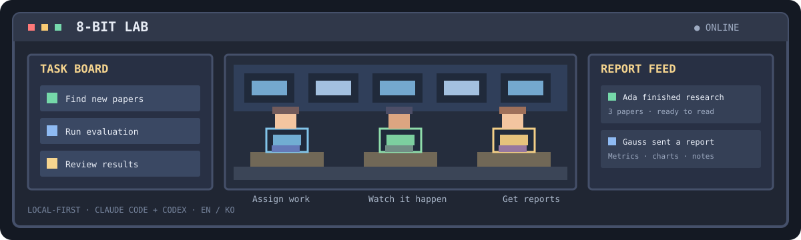

<p align="center"></p>

<h1 align="center">👾 8-bit Lab</h1>

<p align="center"><strong>A pixel-art office for your AI team.</strong><br>Assign work to Claude Code or Codex agents, watch them work, approve requests, and collect their reports in one place.</p>

<p align="center">
  <a href="https://github.com/turtle505/eightbit-lab/actions/workflows/ci.yml"></a>
  <a href="LICENSE"></a>
  <a href="package.json"></a>
  <a href="package.json"></a>
  <a href="README.ko.md"></a>
</p>

<p align="center"><strong>English</strong> · <a href="README.ko.md">한국어</a> &nbsp;|&nbsp; <a href="#why">Why</a> · <a href="#installation">Installation</a> · <a href="#tutorial">Tutorial</a> · <a href="#controls">Controls</a> · <a href="#optional-features">Features</a> · <a href="#safety">Safety</a></p>

## Why

If you run Claude Code or Codex in several terminals, it gets hard to follow who is doing what once there are more than a few. You find a window that stopped to ask for approval twenty minutes ago, or scroll back through output looking for a result.

8-bit Lab puts those agents on one screen. The characters show what each one is doing. Anything that needs care, like deleting files, git push or connecting to a lab server, asks before it runs. Finished work stays in the report feed and on the task board. Recurring work can be scheduled as a routine, and when a GPU job finishes, the employee who submitted it reports the result.

I built it for my own use in a research lab as a grad student, so the default staff cover literature search, evaluation and experiments. The roles are set in a config file and can be changed.

| Your team | Your desk |
|---|---|
| 🧑‍💻 **Six employees** for research, evaluation, engineering, and coordination. Choose Claude Code or Codex per employee. | 👀 **Live pixel office** shows who's thinking, editing, running commands, or waiting for you. |
| 📋 **Task board & reports** keep assignments, results, and saved Markdown reports together. | ✋ **Approval cards** put sensitive actions in front of you; remote lab access always asks. |
| ⏰ **Routines** schedule recurring work through the assistant. | 🖥️ **GPU jobs** run on SSH or Slurm servers and report back when finished. |

Runs locally on macOS or Linux using your own CLI login. Claude Code requires a Claude Pro/Max plan; Codex uses a ChatGPT login. The app does not need an API key. Set your team's field in one line, or use the defaults.

> **Project status:** Built for daily use and still evolving. Independent of Anthropic and OpenAI.

---

## Installation

### Requirements

- **Node.js 22.13 or newer** (24 recommended). The app uses the built-in `node:sqlite`, which older versions only offer behind a flag. With nvm, `nvm use` picks the right one (`.nvmrc`); `npm start` refuses older versions with a clear message.
- **Claude Code CLI**, logged in with a Pro or Max plan. Run `claude` once and sign in. Check with `claude --version`.
- macOS or Linux. Optional: `pdftotext` (poppler) so PDF attachments are handed over as text, which costs far fewer tokens.

### Run

```bash
git clone https://github.com/turtle505/eightbit-lab.git
cd eightbit-lab
npm install
npm run dev
```

Open **http://localhost:5173**. No configuration is needed to start.

---

## Tutorial

You are the **manager**, at the big desk at the bottom of the office. Your six employees are in the lounge having ☕, waiting for orders. Clear these four stages in order and you'll know every basic control.

### Stage 1: Your first instruction

1. Click **Alan** (or press <kbd>1</kbd>).
2. Type in the box under the office and press Enter: *"Find three recent papers on retrieval-augmented generation and summarise them."*
3. Alan walks to his desk and starts working. The speech bubble over his head shows what he's doing right now.

> 💡 The first instruction to each employee takes a few seconds while their session starts. After that, replies start almost instantly.

**Clear when:** Alan is typing at her desk.

### Stage 2: Approve something

When an employee **raises a hand with a `!`**, they need your OK. Read what they want to do in the yellow approval panel, then **approve** or **deny**. Risky actions (deletes, git push, reaching a remote server and the like) are marked.

**Clear when:** you've handled one approval card. (If nobody raised a hand, you skipped this stage.)

### Stage 3: Collect the report

When the work is done, the employee sparkles ✨ and the answer lands in the **📨 Reports** feed (and as a desktop notification, if you turn those on).

**Clear when:** you've read Alan's summary in the feed.

### Stage 4: Task cards

Bigger jobs go on a card instead of a chat line.

1. On the **task board** on the right, type a title and press **Add**.
2. Drag the card onto an employee in the office.
3. Finished cards move to *Review* with the report attached. Click the title to read it, then **Done**.

**Clear when:** a card reaches *Done*. That's all the basic controls.

### Bonus stage: the two in the corner, and the professor

**Kang** (<kbd>7</kbd>) and **On** (<kbd>8</kbd>) stand on the rug in the bottom-left corner with no desk, and they don't do work. Talk to them on a rough day; the conversation plays out in speech bubbles like game dialogue.

- **Kang** sighs at whatever you say and answers with sarcasm. Don't expect comfort.
- **On** asks questions the way a counselor does and helps you sort things out.
- **The professor** (<kbd>9</kbd>) stands on the podium on the right: a satire of the advisor every grad student knows, who answers anything with "So, any results yet?". Send `quote: that won't take long, right?` and he learns your real advisor's lines and riffs on them.

---

## Controls

Once the tutorial is cleared, this is the full list of controls.

| Action | How |
|---|---|
| Give an instruction | Click an employee (or pick one in the box right under the office) → type and press Enter. <kbd>/</kbd> jumps to the box |
| Assign a task | Add a card on the task board → drag it onto an employee (or pick from the card's dropdown) |
| Approve / deny | Use the yellow approval panel (<kbd>a</kbd> / <kbd>d</kbd> in the console view) |
| Check results | Finished cards move to **Review** (newest on top): click a card title to open its report, then **Done**, or **All done** for the whole column. Done keeps the latest five in view |
| Group work by research topic | The **Topic** box in the task form (e.g. `design-survey`; earlier topics are suggested). The employee files that task's reports under `reports/<topic>/`, and a task that follows another takes its topic. Lower-case letters, digits and hyphens only, since it becomes a folder name |
| Read old reports | **Reports** tab: every `.md` report as a folder tree, with unread counts. Tick **By topic** to group them by topic instead of by employee |
| Keep a lab notebook | Nothing to do: whenever a task or a GPU job ends, the office adds an entry (time, task, who, topic, the start of the result, the files it names) to `workspaces/notebook/<date>.md`. Type `/note <text>` in the instruction box to add a line of your own; it goes to the notebook, not to an employee. Read it under **notebook** in the Reports tab. No model is called for any of this; `notebook: false` in `office.local.yaml` turns it off |
| Compare experiments | **📊 Experiments** in the jobs panel: one row per run, with the setup it was run with and the metrics that came out, as columns. Filter by topic, click a column to sort, the best value of each metric is bold (↑↓ switches whether higher or lower is better), **Copy CSV** for a spreadsheet. Rows appear when an employee records a result: after a GPU job they are asked to, and for anything else ("evaluate the checkpoint and record the numbers") they use the same tool |
| Find something from before | The search box in the top bar (<kbd>Ctrl</kbd>/<kbd>⌘</kbd>+<kbd>K</kbd>): looks through report text, employee logs, task cards, the report feed and recorded experiments. Several words must all occur |
| Restart a task that did not finish | A card whose run failed stays in **In progress** with a red ⚠ and the reason; one you stopped shows ⏹, and one cut off by a server restart is marked too. **↻ Try again** starts it again with the same employee, who is told what happened to the earlier attempt; to hand it to someone else, pick them in the card's dropdown. A card waiting on it shows *waiting: #n failed* until then |
| Stop someone | **Stop** in the employee panel (ends the current turn, keeps the conversation) |
| Start fresh | **New session** in the employee panel (clears the conversation) |
| Do something later, once | ⏰ in the task form (pick an assignee and a time), or ask the assistant: *"tomorrow at 9, have Alan summarise the new papers"* |
| Start a task when another finishes | In the task form, pick the earlier task under **⛓ Start right away** (and an assignee). The card waits, then starts by itself with the earlier task's result in its instructions. **▶ Start now** on the card skips the wait. The team lead can do the same when handing out work |
| Schedule recurring work | Routine panel → **+ New routine**, or just ask the assistant |
| Update the office | **⬆ New version n** in the top bar, when the remote has new commits → see what changed → **Update** (see *Updating it later*) |
| Switch views | **Game / Console / Reports / Projects** at the top right, or <kbd>`</kbd> |
| Switch language | The **EN / 한국어** button at the top right |
| Rename the office | Click the title in the top bar. It also shows in the browser tab, desktop notifications and the login page; empty brings back "8-bit Lab" |

**Views.** *Game* is the pixel office. *Console* shows the same data as tables: staff, tasks, a combined activity feed and approvals, all driven from the keyboard. *Reports* is a reader for report files. Add `?view=console` or `?view=reports` to the URL to open one directly.

**Hotkeys** (console): <kbd>1</kbd>–<kbd>6</kbd> select · <kbd>j</kbd>/<kbd>k</kbd> move · <kbd>/</kbd> instruct · <kbd>a</kbd>/<kbd>d</kbd> approve/deny · <kbd>Esc</kbd> deselect. <kbd>Ctrl</kbd>/<kbd>⌘</kbd>+<kbd>K</kbd> searches the records from any view.

**Status signs.** A glance at a character tells you what they're doing.

| You see | Status |
|---|---|
| ☕ In the lounge | Idle |
| Typing at the desk | Working. The monitor is blue when editing, green when running commands, sky blue when on the web |
| `...` | Thinking |
| ✋ Hand up with `!` | Waiting for your approval |
| ✨ Sparkle | Just finished |

**Subscription usage.** The top bar shows your Claude plan's **5-hour and weekly usage** and Codex's **remaining quota** when available, with reset times. The number in each employee's panel is *their share* of the office's total Claude usage, not a percentage of a limit. If the Claude 5-hour window runs out mid-task, the employee pauses and **picks the work up again by itself** when the window resets. **▶️ Resume now** skips the wait.

---

## Customising

Everything lives in `config/`. **Don't edit the committed files for personal settings.** Put them in `config/<name>.local.yaml` next to them instead. Those files are git-ignored and layered on top:

- `office.local.yaml` overrides keys one by one.
- In the employee, routine and server lists, an entry with the same `id` (servers: `name`) replaces the default, and a new one is added.

```yaml
# config/office.local.yaml (a typical one)
domain: "a computer-vision lab working on video understanding"   # what your team works on, in one line
language: en              # en | ko: UI and the language employees report in
maxConcurrent: 3          # employees working at the same time (protects your subscription's rate limit)
researchRepo: ~/research/my-model   # optional: each engineer gets their own git worktree of this repo
authToken: ""             # optional: lock the office with a password (see "Safety")
```

| File | What it controls |
|---|---|
| `config/office.yaml` | Your field (`domain`), concurrency, model, language, idle timeout, hosts, local models |
| `config/roles.yaml` | The employees: name, role prompt, tools they may use without asking (`autoAllow`), sprite colours and `look` (a hairstyle or hat) |
| `config/routines.yaml` | Starter routines: weekday 09:00 morning briefing, weekday 18:00 evening report, Friday 17:00 weekly review (off) |
| `config/servers.local.yaml` | Your GPU servers (copy `servers.example.yaml`) |

**Workspaces.** With `researchRepo` set, each engineer works in their own git worktree (branch `office/<id>`), so they don't step on each other. Without it, everyone shares `workspaces/shared`. Reports go to `workspaces/<employee>/reports/`, and inside it employees follow one layout: `reports/<topic>/<date>-<short-title>.md` for a research topic (with `figures/` and `data/` beside it and a `README.md` listing the topic's reports), `reports/daily/` for recurring briefings, `reports/misc/` for one-offs. Every report opens with the same header (date, author, task, topic, status, inputs, outputs), and scratch work stays out of `reports/`, in `work/<topic>/`. The rule lives in the `common:` block of `roles.yaml` and applies to reports written from now on; older ones stay where they are unless you ask the assistant to tidy them.

**The team.**

| id | Who | What they do |
|---|---|---|
| `lit` | Alan | Papers and web research |
| `eval` | Gauss | Metrics, figures, evaluation reports |
| `aide1`, `aide2` | Finn, Mira | Research aides who take whatever is handed over |
| `sec` | Hana | The assistant: routines, office overview, organising reports |
| `exec` | Linus 👑 | Lead engineer: implements, runs GPU jobs and delegates to the others |
| `thug` | Kang | Street punk who sighs at your whining and roasts you with blunt facts, never sympathy |
| `counsel` | On | A counselor who works through things with you using real counseling techniques, and keeps session notes |
| `prof` | Professor | A satire of the classic advisor: no help, only more work |

Kang and On aren't there for work. They stand on a rug in the bottom-left corner with no desk, keep their replies to a sentence or two, and talk in speech bubbles: their reply over their head, what you said over yours. They answer in the office language (in Korean they go by 깡 and 온) and take keys <kbd>7</kbd>/<kbd>8</kbd>; the team lead never hands them tasks. Kang quietly keeps what you tell him in `workspaces/thug/notes.md` as roast material, so it survives a new session; On keeps session notes the same way in `workspaces/counsel/notes.md` and picks up where you left off. Delete a file to make its owner forget.

The professor is also someone to talk to, not a worker. Add quotes by sending `quote: …` in chat, or by writing `- ` lines in `workspaces/prof/quotes.md` yourself; that file is never committed. Rename him with ✏️ in the employee panel.

**Fitting them to your field.** Setting `domain` is usually enough: every employee's prompt starts with `About this team: <domain>`. To go further — say, the evaluation analyst should know your field's metrics, or the researcher may use a paper-search MCP server you've installed — override that employee in `config/roles.local.yaml`. Entries are merged by `id`, field by field:

```yaml
# config/roles.local.yaml
employees:
  - id: lit
    autoAllow: [Read, Glob, Grep, WebSearch, WebFetch, Write, Edit, TodoWrite, mcp__arxiv]   # + your MCP server
  - id: eval
    systemPrompt: |
      ## Your role: Evaluation Analyst
      You compute and interpret mAP, IoU and per-class recall for our detection models …
```

Under each role, every prompt also gets the shared rules from the `common:` block of `roles.yaml` (report honestly, read before changing, the report format), plus a `servers:` block of remote-server etiquette when you have GPU servers or remote hosts. Removing an employee doesn't lose their task cards; they go back to *unassigned*.

**Language.** Employees always get their instructions in English; only the language they *report* in follows the setting. The header button overrides `language:` and is remembered. Old logs and feed entries keep the language they were written in, and routines already saved aren't retranslated.

**Routines with the assistant.** Tell Hana *"every Friday at 5, summarise what everyone did this week"*. She asks a few questions, then writes the steps down as an **office skill** (`workspaces/office-skills/skills/<name>/SKILL.md`) and schedules a routine that runs it. A skill can list commands it may run without asking (`office-allow`). That only holds while the file is exactly the version you approved: if it changes, the routine panel shows **⚠️ Needs re-approval**. Routines use 5-field cron in the backend machine's local time, and only run while the backend is up.

---

## Optional features

### Codex employees

In an employee panel, choose **Codex** from the engine selector after the employee's current work finishes. The choice persists; switching back to Claude restores that employee's separate Claude conversation. Codex runs through its local app-server with your ChatGPT login, so install the official Codex CLI and run `codex login` on the backend machine. For a remote employee host, install and sign in there too; set `codexPath` to the CLI's absolute path in that host's `office.local.yaml` entry if a non-login SSH shell cannot find it. On a headless host, `codex login --device-auth` is an option. Codex uses the CLI model configured on the host, including when resuming an employee conversation. If the account rejects the default model, set `model = "<supported-model>"` at the top of that host's `~/.codex/config.toml`. Codex uses the same task board, report feed, approval cards, and office/lab tools. In auto mode it accepts routine Codex command and file approvals; SSH/lab access, certain destructive commands, and extra filesystem grants still ask. The header shows Codex quota separately from Claude when the backend host's Codex account reports it.

**The lead picks per task.** When the lead (or the assistant) hands out work, it can run a single task on the other engine without touching that employee's setting: web research goes to Claude (Codex has no network), a finished piece of work can get an independent review on the engine that didn't do it, and work moves off an engine whose quota is nearly spent. Such cards show a **Claude** / **Codex** badge. You can ask for it directly too: *"have Finn write it with Claude, then get Codex to review it"*.

<details>
<summary><b>🖥️ GPU servers (submit and track jobs)</b></summary>

Copy `config/servers.example.yaml` to `config/servers.local.yaml` and list your servers. Each one has `type: ssh` or `type: slurm`, plus an `ssh_host` from your `~/.ssh/config`, which **must log in with a key, without a password**. If the backend itself runs on that machine, use `ssh_host: local`.

Employees then get the `mcp__lab__*` tools: `list_servers`, `gpu_status`, `submit_job`, `job_status`, `tail_log`, `cancel_job` and `fetch_results`. `submit_job` also takes the run's setup (`params`) and topic, and `record_result` writes the final metrics into the experiment table; that one tool is available even with no servers configured, and never needs approval because it only writes to the office's own database. Jobs appear in the jobs panel. When a job finishes, the employee who submitted it is told automatically and reports the result.
</details>

<details>
<summary><b>📁 Project sessions (a Claude Code session in any folder)</b></summary>

In the **Projects** tab, pick a host and an existing folder to open a Claude Code session there. It's like `ssh host`, `cd ~/project/x`, `claude`, but with approvals, logs and reports. One project can run several independent sessions.

- Sessions live in the tab. Press **Bring to office** to give one a desk and a character.
- Sessions share the same approval rules and count towards `maxConcurrent`.
- Closing a session discards its conversation; the files stay.
</details>

<details>
<summary><b>🌍 Running sessions on another machine / moving the backend</b></summary>

List machines under `hosts` in `office.local.yaml`, then give an employee or project `host: <id>`:

```yaml
hosts:
  - { id: desktop, name: "🖥 desktop", ssh: local, projectRoot: "~/project" }
  - { id: gpu1, name: "🧮 gpu1", ssh: gpu1, projectRoot: "~/project", claudePath: "/home/me/.local/bin/claude" }
```

- `ssh: local` is the backend's own machine. Anything else is an ssh alias (key auth).
- Each machine needs its own `claude` install and login. Give `claudePath` as an **absolute path**, because non-interactive ssh usually lacks `~/.local/bin`.
- Remote sessions can't read attachments, which live on the backend's disk.
- A conversation only exists on the machine that ran it, so moving an employee starts a new session.

**Shared servers dislike noisy clients**, so the office is careful with ssh:

- Short commands reuse one connection per host.
- A reachable host is checked once and then left alone.
- Each host has a budget of `sshPerMinute` connections (default 5; set per host on its `hosts` entry, `0` = unlimited). Employees' own `ssh`/`scp`/`rsync` count towards it too. Over the budget, the command is refused with a "try again in N seconds" message.
- The host badge shows ⏳ when the budget is nearly spent.

**Moving the backend to a server:** `git clone` → `npm ci` → `npm run build` → see `deploy/eightbit-lab.service`. Copy `data/office.db` and `workspaces/` across to keep tasks, routines and attachments. Don't run two backends at once, or routines will fire twice.

**Opening it from another computer:** the backend listens on `127.0.0.1` only, so reach it through an ssh tunnel rather than opening the port. Give the tunnel its own alias in `~/.ssh/config` on the computer you sit at:

```
Host office-tunnel
    HostName <server address>
    User <you>
    LocalForward 8787 127.0.0.1:8787
    ExitOnForwardFailure yes
    ServerAliveInterval 30
    ServerAliveCountMax 3
    BatchMode yes
```

`ssh -N office-tunnel` then makes `http://localhost:8787` the office for as long as it runs. Keep the local port the same as the backend's: the office only accepts pages from its own port. To have it always there on a Mac, copy `deploy/office-tunnel.plist.example` to `~/Library/LaunchAgents/`, then `launchctl bootstrap gui/$(id -u) <that file>`; it reconnects by itself after sleep or a network change. The key has to work without a prompt (`ssh-add --apple-use-keychain` once if it has a passphrase). Don't bind the backend to a public address instead: whoever reaches the office can have employees run commands on that machine.

**Updating it later:** `npm run update` on that machine. It checks that no employee is mid-work (a restart would cut them off), then pulls, rebuilds and restarts the systemd service. `npm run update -- --force` skips the check.

You can also do it from the screen. The office looks at the git remote every 30 minutes (one `git fetch`; `updateCheck: false` in `office.local.yaml` turns that off), and when there are new commits the top bar shows **⬆ New version n**. Click it to see what changed, then **Update**: it runs the same script, refuses while anyone is working, shows the script's output, and reloads the page once the backend is back. The button appears only where the backend runs as the systemd service; anywhere else the dialog tells you to run `npm run update` yourself. There is no force option on the screen.
</details>

<details>
<summary><b>✅ Today's to-dos from Obsidian</b></summary>

Point the office at your vault and the **✅ Today's to-dos** panel shows the checkboxes in today's daily note. You can tick, edit (double-click), add and delete items. Changes are written straight to the note, and edits made in Obsidian show up within seconds. If the line changed in Obsidian meanwhile, the office refuses your edit rather than overwrite it.

```yaml
obsidian:
  vault: /path/to/vault
  daily: "{YYYY}-{MM}-{DD}.md"     # Obsidian's default; e.g. "Daily/{YYYY}/{YYYY}.{MM}.{DD}.{ddd}.md" for a folder per year
  # sections: [Today, Projects]    # only these "## " headings (default: all of them)
  # schedule: [Schedule, 일정]      # headings whose plain bullets are appointments, shown too
```

Any plain note works: every `- [ ]` under a `## ` heading is shown, grouped by heading, and a note without headings is read as one list. Optionally, a line that is only **bold text** starts a named group inside a section, and a trailing `↻3` on an item is shown as "carried over 3 times".
</details>

<details>
<summary><b>📱 Notifications on your phone</b></summary>

The browser can only notify you while an office tab is open. To hear about approvals, finished work, failed runs, GPU jobs and scheduled starts when you're away, have the office push them to your phone with [ntfy](https://ntfy.sh) (free, no account) or a Slack/Discord webhook:

1. Install the ntfy app and subscribe to a topic with a long random name (e.g. `office-7f3k9q2m`).
2. Add it to `config/office.local.yaml` on the machine running the backend, and restart:
   ```yaml
   notify:
     ntfy: https://ntfy.sh/office-7f3k9q2m
     # webhook: https://hooks.slack.com/services/...   # or/also a Slack/Discord incoming webhook
     # events: [approval, result, error, job, scheduled]
   ```
3. `npm run notify:test`: your phone should buzz.

Nothing is sent while an office tab is in front somewhere (`whenAway: false` to always send). Notifications carry only who and what (for example "✅ Alan: 📋 #12 Summarise the paper"), not the reply, unless you set `preview: true`. **Anyone who knows an ntfy.sh topic can read it**, so treat its name like a password, or self-host ntfy.
</details>

<details>
<summary><b>📎 Attachments</b></summary>

Drop files on 📎 in the task form or on an employee's input box (up to 50 MB each). The employee gets the file paths with the instruction.

- CSV, text, JSON and images are read directly.
- A PDF's text is taken out when you upload it (needs `pdftotext`: `apt install poppler-utils` / `brew install poppler`), with a line marking where each page starts. The employee reads that text and opens the PDF only for the pages where it needs a figure, table or equation. A PDF read whole costs several times its text, since every page also goes in as an image. Without `pdftotext`, or for a scan with no text layer, the PDF is handed over as it is.
- Word, RTF, ODT and HTML files also get a `.txt` conversion (`textutil` on macOS, LibreOffice elsewhere).
- Excel files are read with pandas.
- Uploads you never attach to anything are deleted after 24 hours.
</details>

<details>
<summary><b>🦙 An employee on a local model (Ollama)</b></summary>

Any employee can run on an Ollama model instead of your subscription, which is good for light work like summaries and notes. Add the provider in `office.local.yaml`, then point an employee at it in `roles.local.yaml`:

```yaml
# config/office.local.yaml
providers:
  - { id: workstation, name: "🖥 workstation", kind: ollama, ssh_host: workstation, remotePort: 11434, localPort: 11435, model: "qwen3:8b" }
```

```yaml
# config/roles.local.yaml
employees:
  - { id: aide2, provider: workstation }
```

- The office opens the ssh tunnel itself and health-checks it.
- Start Ollama with a **64k+ context** (`OLLAMA_CONTEXT_LENGTH=65536 ollama serve`), because Claude Code's own prompt is over 20k tokens.
- Pick the model from the employee panel.
- These employees don't count towards `maxConcurrent`.
</details>

---

## Safety

Agents can read untrusted web pages and papers, so the office keeps a few guard rails on.

- **Auto mode by default.** Each employee runs in **🤖 Auto**: a classifier approves clearly safe tool calls, and anything unclear becomes an approval card. Switch an employee to **✋ Ask** to approve everything yourself.
- **Lab servers always ask.** Submitting, cancelling or fetching jobs on another machine, and any `ssh`/`scp`/`rsync`/`sftp` command, always show an approval card, even in auto mode. So one hidden instruction in a web page can't run commands on your GPU server. Read-only checks (GPU status, job status, logs) don't ask.
- **🔒 per task.** Tick 🔒 on a task card and that task asks for every tool outside the employee's allow-list.
- **Loopback only.** The backend listens on `127.0.0.1` and refuses browser requests from other origins, so a random web page you have open can't drive the office.
- **Optional password.** Set `authToken` in `office.local.yaml` if other people can log in to the machine. Browsers enter it once and get a cookie; scripts send `X-Office-Token: <token>`.

---

## Troubleshooting

| Problem | Try |
|---|---|
| Usage shows "—" | The usage check uses an experimental API and may be unavailable. Everything else still works |
| An employee shows ⏸ **Usage limit** | Your 5-hour window ran out. They resume by themselves at the shown time, or press ▶️ **Resume now** |
| An employee seems stuck | Open their panel and check the log; **Stop**, then instruct again. **New session** if the conversation went off the rails |
| A host badge says it can't connect | Check `ssh <alias>` works without a password, then press ↻ on the badge |
| New tool or option not picked up | Long-lived sessions cache tool lists: press **New session** |

---

## For developers

```bash
npm run dev         # backend (tsx watch, :8787) + Vite (:5173)
npm run build && npm start   # production: backend serves dist/ on 127.0.0.1:8787
npm test            # unit tests (vitest)
npm run typecheck
```

```
shared/protocol.ts     every message between server and browser
shared/i18n.ts         ko/en switch: tr({ ko, en }), locale helpers
server/src/agents/     AgentManager: one long-lived Agent SDK session per employee, queue, permissions
server/src/compute/    ssh / slurm adapters, server polling, job tracking
server/src/mcp/        tools for agents: lab (GPU servers), office (for the assistant)
web/src/game/          the pixel office (sprites drawn in code)
web/src/ui/            panels, console, reports, projects
```

[CLAUDE.md](CLAUDE.md) explains the architecture in detail. Data lives in `data/office.db` (SQLite) and `workspaces/`; both are git-ignored.

## License

MIT
